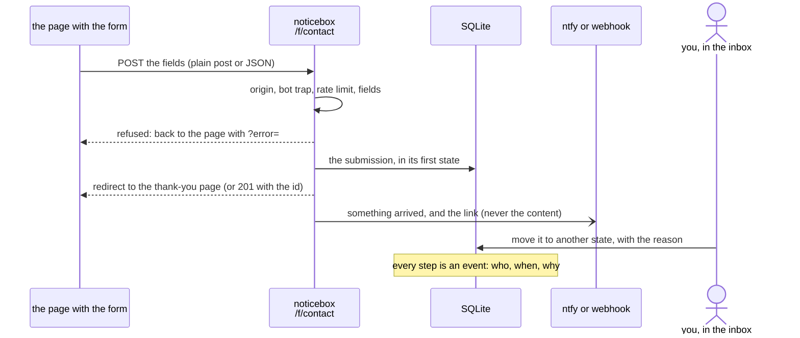

# Concepts

The words the rest of the documentation uses.

**Box.** A group of forms: a site, a project. The sidebar lists boxes and their forms. A box is nothing but the `box` name on each form.

**Form.** What a page posts to: a name, its states, the fields it knows about, where posts may come from, where the browser goes afterwards, how long closed submissions keep personal data, where to announce a new one, and a link to what a submission is about. A form takes any field a page posts unless it is strict. All of it is in the database, made and changed in the inbox or over MCP.

**Kind.** The preset of states a form starts with. A **report** is a notice about content: *open*, *in review*, *acted on*, *rejected*. A **message** is *new* until *answered*. The states can be changed per form. [States, reasons and kinds](../using/kinds.md) has the details.

**Submission.** One post to a form: its fields, when it arrived, where from, and its state.

The path of one submission: the checks come first, so a refused post stores nothing; the notification carries only the link; every later decision is added to the submission's history.

**State and decision.** A submission can be moved to any other of its form's states. A state can be flagged closed (done, and under retention) and flagged as needing a reason: the reason is the record of the decision.

**History.** Every step a submission took: received, moved from one state to another, or a note added; by whom, when, with what reason. The history is append-only; nothing in it is ever changed or removed.

**Actor.** The person who took a step, by the username they [signed in](../self-hosting/login.md#one-person-one-name) with. A step taken by an assistant through MCP is recorded as *name via client*.

**Retention.** A submission closed longer ago than its form's `retentionDays` loses its personal fields: free text, addresses, anything not marked `personal: false`. The ids, the chosen category, the states and the history stay, unless the form also sets `deleteAfterDays`: after that, the whole submission is deleted.

**Link.** A form's `link` is a URL template over its fields, such as `https://notefeed.me/r/{read_id}/{note_id}`. Each submission shows it filled in, so the thing it is about is one click away.

**Endpoint.** `POST /f/<form>`: where a page or a script posts. It is public; the inbox is not.
