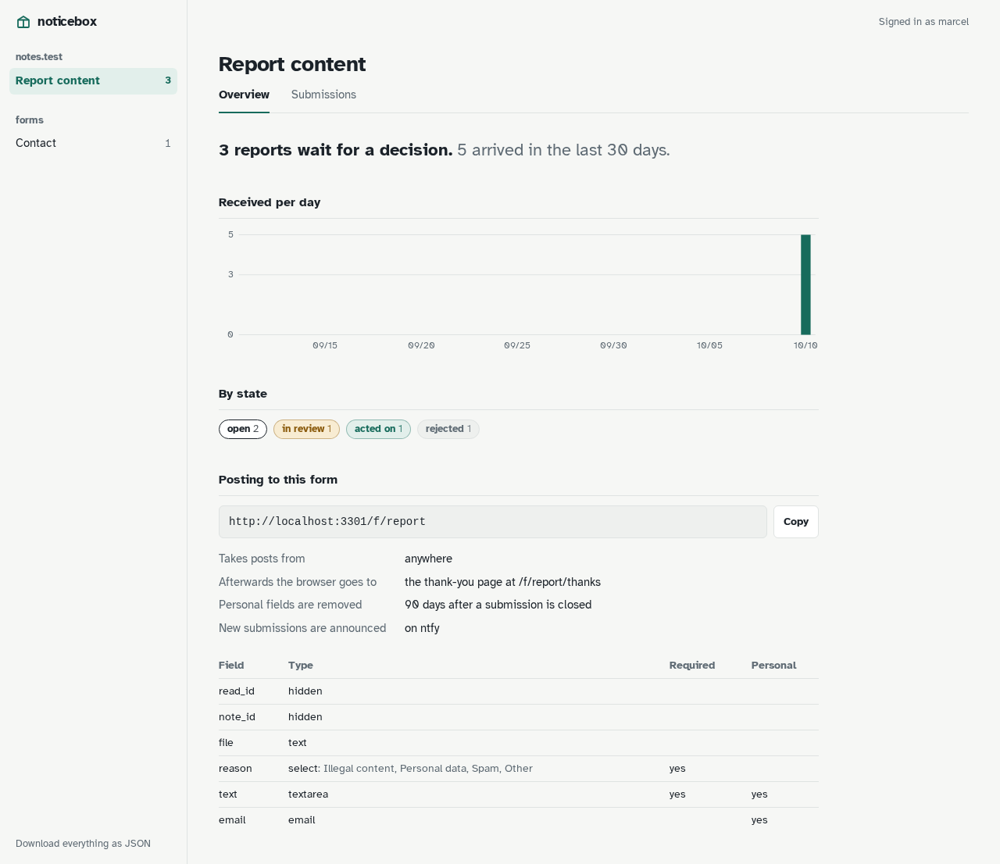

# noticebox

noticebox is an inbox for the forms on static pages. A page points its form at noticebox, or a script posts JSON there, and what comes in lands in one SQLite file and in an inbox where each submission is walked through its states. Every step, who took it and why, is kept as the record.

It exists for the two forms a small public service needs and no form tool did well: reports about content that should not be there, which must be decided with a written reason and kept as proof, and contact messages, which must be answered. One container, no database server, no accounts of its own: the login is the reverse proxy's.

## Where to go next

- **Get started:** the [Quick start](get-started/quick-start.md) runs noticebox with Docker Compose and takes the first submission; [Concepts](get-started/concepts.md) explains boxes, forms, kinds, states and the audit trail.
- **Using noticebox:** [the inbox](using/inbox.md), and [states, reasons and kinds](using/kinds.md).
- **Integrations:** [posting from a page](integrations/forms.md), plain or with JavaScript, and the [MCP endpoint](integrations/mcp.md) that lets an assistant review in your name.
- **Self-hosting:** [configuration](self-hosting/configuration.md), [the login in front](self-hosting/login.md), [notifications](self-hosting/notifications.md), [retention, export and backups](self-hosting/retention.md) and [upgrading](self-hosting/upgrading.md).
