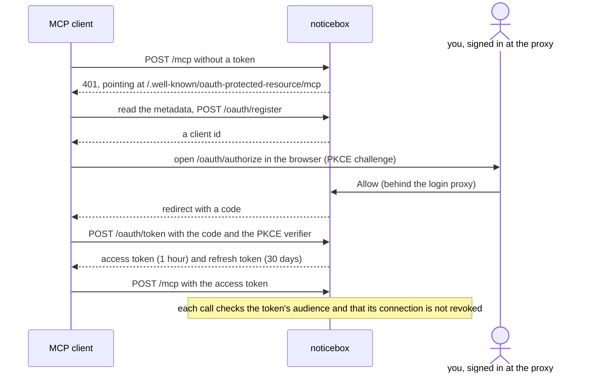

# MCP

noticebox has an MCP endpoint at `/mcp`, so an assistant can read, annotate and decide submissions and set up forms, in the name of the person who allowed it. Everything it does is in the history as *name via client*.

## Connecting

In Claude Code:

```sh
claude mcp add --transport http noticebox https://inbox.example.org/mcp
```

The client registers itself, the browser opens the authorize page, which is behind the same login as the inbox, and *Allow* sends the client its token. Tokens are signed with `NOTICEBOX_SECRET`; without that setting the endpoint does not exist.

Each *Allow* is a connection, listed under *Your settings* with the client's name, when it was allowed and last used. *Revoke* ends it at once: every token of that connection stops working, and the client has to be allowed again.

## Tools

MCP is noticebox's main interface: everything the inbox can do, an assistant can do here.

| Tool | What it does |
|---|---|
| `list_forms` | The boxes and forms, each form with its kind, states and retention |
| `list_submissions` | Submissions, filtered by form, state or open/closed; each with its summary, its URL in the inbox and its link |
| `get_submission` | One submission with its fields and history, and `github_issue_url` when its form names a [repository](github.md) |
| `add_note` | A note on a submission |
| `decide` | A move to another state, with the reason; refused like in the UI when the reason is missing or the move is not allowed |
| `get_form` | One form as it is stored, `${VAR}` references unexpanded, with its figures: open and closed in the last 30 days (by state), the oldest open submission, and when personal fields are next removed |
| `put_form` | Creates a form or replaces it as a whole; the form is validated before it is saved, so an invalid form, a `${VAR}` the environment does not have, or dropping a state that submissions are in changes nothing |
| `delete_form` | Deletes a form without submissions (destructive) |
| `create_box`, `rename_box`, `delete_box` | A box: made, renamed with its forms, deleted once empty (destructive) |
| `list_connections` | Your connected assistants, the current one marked |
| `revoke_connection` | Ends one of your connections at once (destructive) |
| `export` | Every submission with its history, or one form's or state's, up to 1000: the same as `/export.json` |

The tools call the same functions as the inbox's pages, through the same validation; secrets such as an ntfy topic go in as `${VAR}` references that the container's environment must provide.

Every result carries `next`: short instructions built from what the call did, such as when retention will remove a closed submission's personal fields or where a new form takes its posts. Every box, form and submission in a result carries its `url` in the inbox, and a summary carries `link`, the form's link template filled in, so an assistant can look at what a report is about before suggesting a decision.

## How the OAuth works



Only the *Allow* step needs the login proxy; everything else is public and checks the client for itself.

noticebox is its own authorization server: RFC 8414 and RFC 9728 metadata under `/.well-known/`, dynamic client registration at `/oauth/register`, the code flow with PKCE at `/oauth/authorize` and `/oauth/token`, rotating refresh tokens. Access tokens last an hour, refresh tokens thirty days, every token is bound to this instance's `/mcp` as its audience, and every token names the connection it belongs to, which is checked on each call. The authorize page is the only step that needs the login proxy; the rest checks for itself and must be public, see [The login in front](../self-hosting/login.md).
