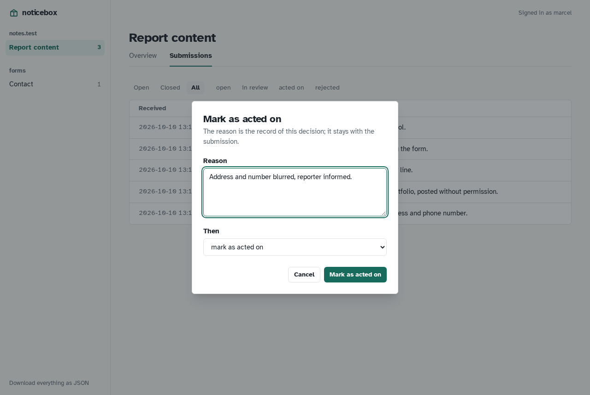
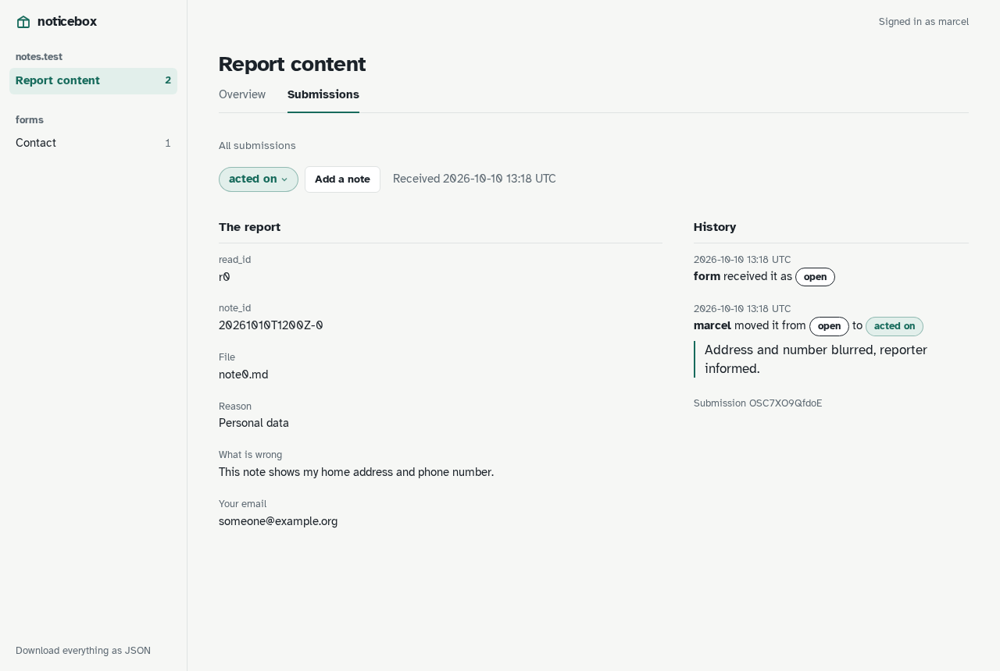

# The inbox

The inbox is where submissions are read and decided. It is behind the login the proxy puts in front; the name in the top right is who the proxy says is signed in, and every step is recorded under that name.

## Sidebar

The boxes and their forms, each form with the number of submissions that wait for a decision. The front door opens the first form. A box's name opens the box's page: its forms, a rename, and its removal once it is empty.

**Add new** makes a form or a box. A new form needs a name (its endpoint, `/f/<name>`, which cannot change later), a box, a kind and a title. It starts without fields: the first submission brings them, or the page [describes them itself](../integrations/forms.md#describing-fields-from-the-page). Every change made here is written to the forms file, validated as a whole first.

## Settings

A form's third tab: title and box; the described fields (name, type, label, required, length, options of a select, whether personal, a help text) and, beside them, the fields seen in submissions that nobody described yet, one click away from being described; the *Strict* switch; the states with their two flags; where posts are accepted from and where the browser goes afterwards; the notification targets (any number of ntfy topics and webhooks); the retention and the link. *Save the settings* writes the file; a refused save says what is wrong and keeps what was typed. A form without submissions can be removed here.

## Overview

A form's first tab: how many submissions wait, how many arrived in the last 30 days, a bar per day, the count per state, and what a page needs to post here: the endpoint, where posts are accepted from, where the browser goes afterwards, the retention, where new submissions are announced, and the fields.

## Submissions

The table of a form. *Open* is the default; *Closed*, *All* and each state are a click away. A row shows when a submission arrived, its state and the first text it contains. The date and the text open the submission; the arrow at the end opens what it is about, when the form has a [link](../get-started/concepts.md).

**The state is a dropdown.** Click the badge: it lists the form's other states, named by what moving there does: *Start review*, *Mark as acted on*, *Mark as rejected*, *Reopen*. Choosing one opens the dialog.

**The dialog.** Write the reason, check the next state, confirm with the button that repeats the action's name. A state that needs a reason refuses to be set without one; the choice stays in the dialog so only the reason has to be added. *Add a note* is the same dialog with the state kept.

## A submission

Its fields as the form labelled them, the state dropdown and *Add a note*, the link to what it is about, when and from where it arrived. Beside it the history: received, each move from one state to another, each note; by whom and when, with the reason. A recorded decision's reason is set large: it is what the box exists to keep.

When the personal fields have been removed by retention, the page says so and shows what is left: the ids, the category, the states and the decisions.

## You

The name in the top right is who the login in front says you are. Its menu opens *Your settings*, with the assistants you allowed through MCP and a *Revoke* for each, and *Sign out*, which goes through the login.

## Download

*Download everything as JSON* in the sidebar gives every submission with its history, for an audit or a migration. `?form=<name>` limits it to one form. See [Retention, export and backups](../self-hosting/retention.md).
