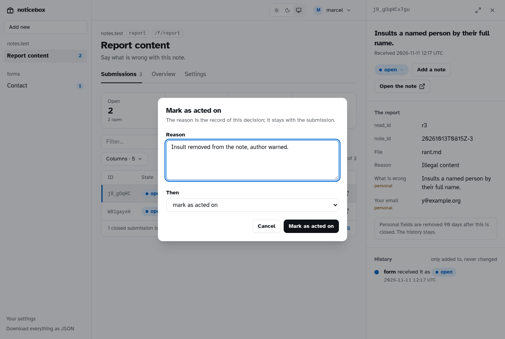
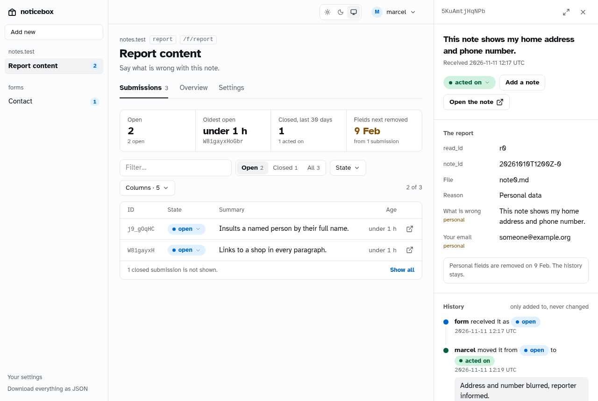

# The inbox

The inbox is where submissions are read and decided. It is behind the login the proxy puts in front; the name in the top right is who the proxy says is signed in, and every step is recorded under that name.

The three buttons beside the name choose the colours: light, dark, or like the system (the default). The choice is kept in this browser only.

## Sidebar

The boxes and their forms, each form with the number of submissions that wait for a decision (highlighted while there are any). The front door opens the first form. A box's name opens the box's page: its forms, a rename, and its removal once it is empty.

**Add new** makes a form or a box. A new form needs a name (its endpoint, `/f/<name>`, which cannot change later), a box, a kind and a title. It starts without fields: the first submission brings them, or the page [describes them itself](../integrations/forms.md#describing-fields-from-the-page). Every change made here is written to the forms file, validated as a whole first.

## A form

Every page of a form starts with its box, its kind and its endpoint, its title, and three tabs: *Submissions* (with how many it keeps), *Overview* and *Settings*.

## Settings

A form's third tab, with the list of its sections at the left on wide screens: title and box; the described fields (name, type, label, required, length, options of a select, whether personal, a help text) and, beside them, the fields seen in submissions that nobody described yet, one click away from being described; the *Strict* switch; the states with their two flags; where posts are accepted from and where the browser goes afterwards; the notification targets (any number of ntfy topics and webhooks); the retention and the link. *Save the settings*, in the bar that stays at the bottom, writes the file; a refused save says what is wrong and keeps what was typed. A form without submissions can be removed here.

## Overview

How many submissions wait, how many arrived in the last 30 days, a bar per day, the count per state, and what a page needs to post here: the endpoint, a plain HTML form built from the described fields to start from, where posts are accepted from, where the browser goes afterwards, the retention, where new submissions are announced, and the fields.

## Submissions

Above the table, four figures:

- **Open**: how many wait for a decision, by state.
- **Oldest open**: how long the longest-waiting one has waited, and its id, which opens it.
- **Closed, last 30 days**: how many were decided, by state.
- **Fields next removed**: the next day [retention](../self-hosting/retention.md) removes personal fields, and from how many submissions. It is amber while something is due.

MCP's `get_form` returns the same figures.

The table of a form: every submission in one table, newest first. A row shows its id, when it arrived, its state, the first text it contains and, while it is open, how long it has waited; the id and the text open the submission, and the arrow at the end opens what it is about, when the form has a [link](../get-started/concepts.md). On a phone only the state and the text are shown. The table opens on the open ones. Above it, the filter box narrows it to rows containing the words typed; *Open*, *Closed* and *All* switch between what waits, what was decided and everything, each with its count; *State* picks one state, shown as a chip whose cross goes back to *Open*. While only the open ones are shown, a line under the table says how many closed ones are left out, with *Show all*. The overview's counts per state open the table on that state. A click on a column heading sorts by it, and again reverses it. *Columns* shows or hides columns, including one for each field of the form.

**The state is a dropdown.** Click the badge: it lists the form's other states, named by what moving there does: *Start review*, *Mark as acted on*, *Mark as rejected*, *Reopen*. Choosing one opens the dialog.

**The dialog.** Write the reason, check the next state, confirm with the button that repeats the action's name. A state that needs a reason refuses to be set without one; the choice stays in the dialog so only the reason has to be added. *Add a note* is the same dialog with the state kept.

## A submission

A submission opens in a pane beside the table, which stays as it was, filters included; its row is marked. On a phone the pane takes the table's place. The cross (or *All submissions*) closes it; the arrows beside it open the same submission on a page of its own, with the fields and the history side by side, and back.

The pane shows the first text as its title, when and from where it arrived, the state dropdown and *Add a note*, the link to what it is about and *Open GitHub issue* when the form has them. Then its fields as the form labelled them, the personal ones marked, and when their removal is due: so many days after closing while it is open, the day itself once it is closed. Then the history: received, each move from one state to another, each note; by whom and when, with the reason set apart, since it is what the box exists to keep.

When the personal fields have been removed by retention, the pane says so and shows what is left: the ids, the category, the states and the decisions.

## You

The name in the top right is who the login in front says you are. Its menu opens *Your settings*, with the assistants you allowed through MCP and a *Revoke* for each, and *Sign out*, which goes through the login.

## Download

*Download everything as JSON* in the sidebar gives every submission with its history, for an audit or a migration. `?form=<name>` limits it to one form. See [Retention, export and backups](../self-hosting/retention.md).
